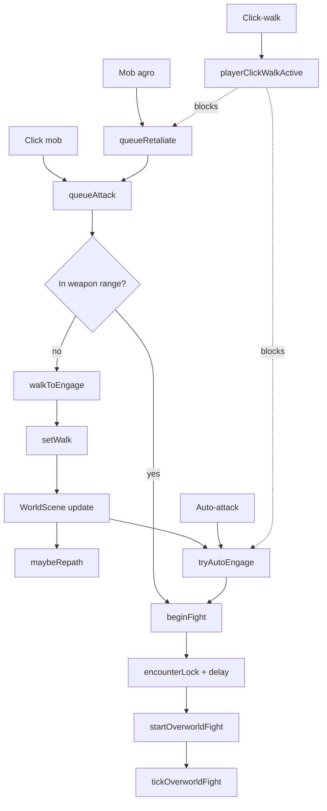
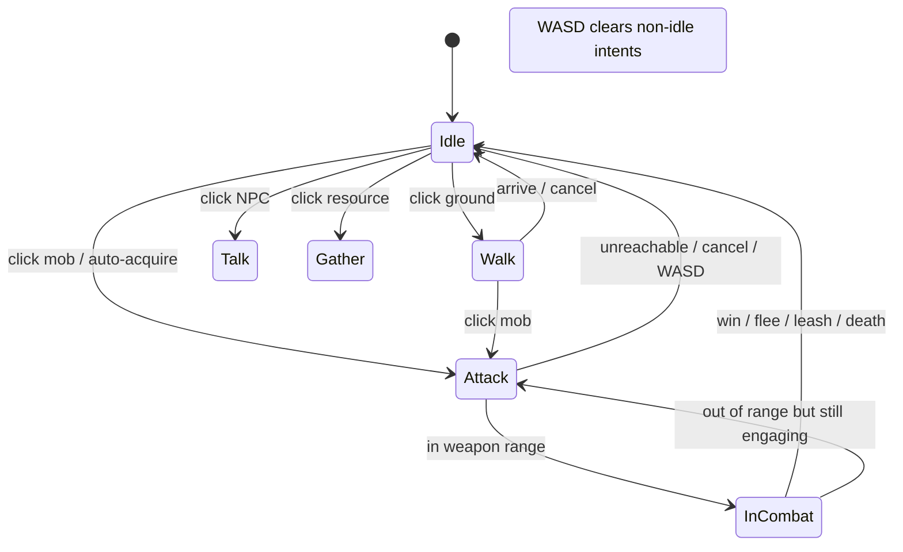

# Combat & movement redesign

## Problem

Overworld combat and movement work, but they share **too many loosely coupled flags** inside [`js/scenes/WorldScene.js`](js/scenes/WorldScene.js) (~7k+ lines). Recent bugs all came from the same shape of bug: one path sets state A, another path only checks state B.

Research pass confirmed combat is already a **three-layer** machine (`engageTarget` intent, `overworldFight` ticks, `agroChasing` mob AI) with one shared walker — the redesign makes that structure explicit and single-writer.

### Current overlapping state

| Flag / object | Meant to mean | Also used as |
|---------------|---------------|--------------|
| `engageTarget` | Click/auto target to chase | Cleared by `beginFight`, fight-close, WASD, UI pause |
| `overworldFight` | Active tick combat | Separate from engage; swings/UI live here |
| `playerClickWalkActive` | Pause autos during click-walk | Historically also blocked engage chase / repath |
| `encounterLock` | Pre-fight shake lock | Blocks engage, agro, clicks |
| `engageGrace` | Post-zone/fight grace | Blocks auto engage/retaliate |
| `_fightPlayerClose` | In-fight retaliate close | Extra chase path beside engage |
| `walkTarget` / `walkPath` / `walkBlocked` | Path follow | Engage used to aim at unwalkable mob tiles |
| `mob.agroChasing` | Mob AI chasing player | Feeds retaliate + rings + hits outside fight |

### Current flow (simplified)



### Bug classes this invites

1. **Acquire vs maintain confusion** — autos gated *swings* once (fixed), but still mixed into chase/close logic. Easy to reintroduce.
2. **Path destination = mob tile** — A* `allowEnd` only waives **occupancy**, never terrain; pathing onto water/rock freezes with “You target…” (partially fixed via `walkToEngage` / `engageStandWorld`).
3. **Pause flag bleed** — `playerClickWalkActive` lingered across attack and suppressed repath; also stacks with `engageGrace`, `encounterLock`, `uiPaused`, `fight.busy`.
4. **Multiple chase authors** — update walk, `maybeRepath`, `tryAutoEngage`, `queueRetaliate`, `_fightPlayerClose` all write walks; `chaseFightMob` currently runs **twice** per `update`.
5. **Dual range vocabularies** — auto-attack acquire uses **Chebyshev tiles**; engage/swing/close use **Euclidean px** (`weaponAttackRangePx` / `mobAttackRangePx`); same pair of sprites can disagree on “in range.”
6. **Logic buried in WorldScene** — orchestration almost entirely in one scene; Hud has a fallback attack path.
7. **`fight.busy` sticky** — if a tick returns early without clearing busy, combat freezes.
8. **260ms `encounterLock` gap** — world frozen between shake and `startOverworldFight`; agro cleared under lock/grace.
9. **Agro damage outside fight** — `applyMobAgroHit` can chip (or kill) with no `overworldFight` when autos are off.
10. **`engageTarget` vs `overworldFight` desync** — `beginFight` nulls engage; mid-fight close re-sets it; click-walk / WASD / leash clear different subsets.

Intentional product rules to **keep** (from GDD):

- Click-to-attack walks into **weapon** range then fights
- Auto-attack (default off) acquires nearby foes; paused during player click-walk
- Auto-retaliate (default off) only after **mob agros first**; chase also paused during click-walk
- Once fighting, swings every tick in weapon range (autos do not gate damage)
- In-fight auto-close only inside **mob attack range** when retaliate on
- No diagonal corner-cut / squeeze

---

## Proposed system

### Design principle

Split into three layers with **one writer each**:

1. **PlayerIntent** — what the player is trying to do (walk / attack / talk / loot / gather / idle)
2. **CombatController** — how fights are acquired, maintained, and ended
3. **MobAgroAI** — mob chase/leash/safe/hits; emits “agro on player” events

Movement resolves **only** from intent (plus WASD override). Combat never secretly toggles walk flags except by setting intent to `attack`.



### 1. PlayerIntent (replace parallel chase flags)

Single object on WorldScene (or small module):

```js
playerIntent = {
  kind: 'idle' | 'walk' | 'attack' | 'talk' | 'loot' | 'fish' | 'chop' | 'mine' | 'station',
  target: null,          // mob / npc / drop / scenery
  dest: null,            // world {x,y} stand tile
  pauseAutos: false,     // true only for kind==='walk' from player click
  silent: false
}
```

Rules:

- `setIntent(next)` is the **only** API that changes intent (clears incompatible targets)
- WASD → `setIntent({ kind: 'idle' })` + clear walk (same cancel UX as today)
- Click ground → `kind: 'walk'`, `pauseAutos: true`
- Click mob / Attack menu → `kind: 'attack'`, `pauseAutos: false`, dest = stand-in-weapon-range
- Arrive at dest: if `attack` and in range → CombatController.start; else clear to idle / complete gather
- Auto-attack / retaliate may call `setIntent(attack)` **only if** `!intent.pauseAutos` and no higher-priority player intent

Deprecate as first-class flags: `engageTarget`, `talkTarget`, `lootTarget`, `playerClickWalkActive`, `_fightPlayerClose` (fold into intent + combat).

### 2. CombatController (new module)

Add [`js/world/CombatController.js`](js/world/CombatController.js) (or extend [`js/world/OverworldCombat.js`](js/world/OverworldCombat.js)) owning:

| Phase | Responsibility |
|-------|----------------|
| **Acquire** | `tryAcquire(source, mob)` — `source`: `click` \| `autoAttack` \| `retaliate` |
| **Start** | `begin(mob)` — shake/lock → `overworldFight` (move out of WorldScene methods gradually) |
| **Maintain** | `tick()` — player swing if in weapon range; mob swing if in mob attack range; never re-check autos for swinging |
| **Chase policy** | While `intent.kind==='attack'` or (in fight + retaliate + inside mob attack range), ask movement for stand-in-range dest |
| **End** | win / lose / flee / leash — clear fight + intent if still attack |

Acquire policy matrix (explicit, one place):

| Source | Requires | Paused by click-walk | Picks passive nearby |
|--------|----------|----------------------|----------------------|
| `click` | Living mob | No (click-walk cancelled) | N/A |
| `autoAttack` | Setting on + Chebyshev ≤ auto range | Yes | Yes |
| `retaliate` | Setting on + mob agroing player | Yes | No |

### 3. Unified range + stand API

Keep numbers in one helper surface ([`js/data/Items.js`](js/data/Items.js) / [`js/world/OverworldCombat.js`](js/world/OverworldCombat.js)):

| Helper | Metric | Used for |
|--------|--------|----------|
| `weaponRangePx(hero)` | Euclidean px | Engage + player swings + stand tile |
| `autoAcquireRangeTiles(hero)` | Chebyshev tiles | Auto-attack **acquire only** (keep distinct on purpose) |
| `mobAttackRangePx(mob)` | Euclidean px | Mob swings + in-fight close gate |
| `MOB_AGGRO_RANGE_PX` | Euclidean px | Mob detection start |
| `standInRangeWorld(...)` | Walkable tile center within weapon px | **All** attack paths (never path onto unwalkable mob tile) |

Document in code that Chebyshev vs Euclidean is intentional for auto-acquire vs swings — callers must not mix them.

WorldScene movement only consumes `intent.dest` produced by that helper.

### 4. Movement arbiter (one place in update)

Each frame, in order:

1. If WASD → clear intent to idle, apply keyboard velocity (hard cancel)
2. Else if `intent.dest` → follow path / repath if target moved (attack/talk/loot)
3. Else stop

In-fight ground click stays **`kind: 'walk'`, `pauseAutos: true`** (today’s kite behavior).

Combat chase (`chaseFightMob` / player close) runs **once** per update, not twice.

No other system calls `setWalk` for combat except via `setIntent` → dest update.

### 5. MobAgroAI stays separate

Keep leash (`MOB_LEASH_TILES` Chebyshev from home) / haven safe / wander in WorldScene or a thin `MobAgro.js`, but:

- Publish `onMobAgroHit(mob)` / `onMobAgroChase(mob)`
- CombatController decides retaliate acquire
- Agro damage outside a fight remains allowed (current design) but should share the same damage/VFX helpers as fight ticks
- Leash/safe release must clear **both** fight and attack intent in one call (no stale walk)

---

## Migration plan (incremental, keep game playable)

Do **not** rewrite WorldScene in one shot. Ship in layers:

1. **Range + stand API consolidation** — done (`standInRangeWorld` / `walkToEngage`).
2. **Introduce `playerIntent`** — done; `engageTarget` / `playerClickWalkActive` are mirrors.
3. **Extract CombatController** — done for acquire, intent, begin/end/leash hooks; tick bodies remain on WorldScene (called from sim).
4. **Intent-primary clears** — done (`clearAttackIntent`, `cancelPlayerCombat`, chase via `attackIntentTarget` / `chaseAutosPaused`).
5. **GDD + loop-tasks** — done.

**Remaining optional polish (not blocking):** move `tickOverworldFight` body into Controller; delete mirror fields after Hud stops reading them.

Testing remains disabled until human re-enables; rely on human playtest of click-attack, auto-attack, retaliate, click-walk pause, water crabs, haven chickens.

---

## Success criteria

- One obvious place to answer: “Why didn’t I attack?” (intent + acquire log/reason)
- Click-walk cannot leave attack chase half-paused
- Autos never gate swings inside an active fight
- Attack pathing always targets stand-in-weapon-range
- Adding a new acquire mode (e.g. spell on target) does not require editing five chase sites

## Out of scope

- Reintroducing full-screen `BattleScene` as primary combat
- Changing default autos (stay Off) or moving them off Combat tab
- Reworking gather action state (can adopt same intent kinds later)
