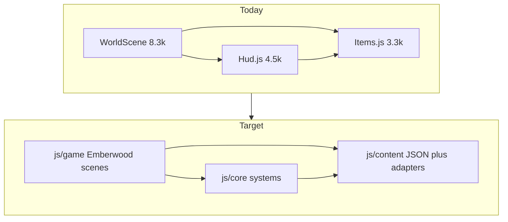

# Emberwood → reusable Phaser framework

**Investigation status:** Complete (2026-11-13). Plan body is the full design — not a stub.

**Constraint:** Phaser **3.90** + Vue CDN, **no bundler**, `<script>` + `?v=` cache-bust. Testing remains disabled until human re-enables.

---

## 1. Why this matters

Content is already table-driven, but tables live **inside** logic megamodules as globals. Three files hold most of the game:

| Hotspot | ~LOC | Role |
|---------|------|------|
| [js/scenes/WorldScene.js](js/scenes/WorldScene.js) | **8274** | Zone, spawn, gather×4, combat chase, loot, stations, sim tick, world save |
| [js/ui/Hud.js](js/ui/Hud.js) | **4489** | Settings clicks/renders, inv/bank/shop, dialogue, save glue |
| [js/data/Items.js](js/data/Items.js) | **3346** | `ITEM_DB` + shops/recipes + inventory/skills/XP + hero normalize |

Together ≈ **16.1k LOC** — majority of game logic. Framework reuse means keeping **pipelines** and swapping **tables**.



---

## 2. Module inventory (`js/`)

| LOC | Path | Role |
|----:|------|------|
| 8274 | `js/scenes/WorldScene.js` | Overworld runtime |
| 4489 | `js/ui/Hud.js` | Imperative HTML HUD |
| 3346 | `js/data/Items.js` | Items + shops + skills + hero |
| 1783 | `js/world/MapGen.js` | TILE + procedural maps + prop tables |
| 885 | `js/world/Zones.js` | Zones, NPCs, `ZONE_MOB_ROSTER` |
| 579 | `js/world/Pathfind.js` | A*, stand-in-range, haven/mob forbid |
| 455 | `js/scenes/BattleScene.js` | Turn-based battle |
| 431 | `js/ui/Sfx.js` | WebAudio |
| 392 | `js/world/OverworldCombat.js` | Damage/XP/projectiles/agro helpers |
| 292 | `js/world/CombatController.js` | Intent + acquire + fight hooks |
| 253 | `js/ui/HudApp.js` | Vue display mirror |
| 221 | `js/sprites/Unit.js` | Battle sprites |
| 219 | `js/world/GameClock.js` | Sim TPS + gameSpeed |
| 192 | `js/data/Scales.js` | Scales, giants, `lootForMob` |
| 173 | `js/input/Keys.js` | Window keyboard |
| 169 | `js/world/StretchLite.js` | Post-load WorldScene patches |
| 163 | `js/main.js` | Phaser boot + TPS helpers |
| 134 | `js/data/Save.js` | localStorage schema v1 |
| 73 | `js/scenes/BootScene.js` | Preload → Title |
| 55 / 54 / 36 / 21 / 16 / 9 | Title / Message / UI / Player / GameOver / Enemy | Thin scenes/sprites |
| 172 / 54 | `Menu.js` / `Message.js` | **Unused** (not loaded) |

---

## 3. Script load order and dependency chain

From [index.html](index.html):

1. Vue + Phaser CDN  
2. Keys → **Items** → Save → Scales  
3. HudApp → Sfx → Hud  
4. MapGen → Pathfind → CombatController → GameClock → Zones  
5. Unit → PlayerCharacter → Enemy  
6. Boot → Title → **WorldScene**  
7. **OverworldCombat → StretchLite** (must load **after** WorldScene)  
8. BattleScene → UIScene → GameOver → **main.js**

Mental model:

```text
CDN → globals → Boot preload (TILE art + ITEM_DB SVGs [+ future JSON])
  → Title → WorldScene ↔ Battle
       ↑ OverworldCombat + StretchLite patch after WorldScene
```

---

## 4. Already-good seams (build on these)

| Seam | Why |
|------|-----|
| [CombatController.js](js/world/CombatController.js) | PlayerIntent, acquire policy, fight lifecycle — pattern to copy for gather |
| [GameClock.js](js/world/GameClock.js) | TPS × speed, tick conversion |
| [Pathfind.js](js/world/Pathfind.js) | Pure grid algorithms |
| `ZONE_MOB_ROSTER` in [Zones.js](js/world/Zones.js) | Single source for bands, labels, `MOB_DEFS` |
| [Save.js](js/data/Save.js) | Thin schema envelope; world blob from WorldScene export |
| Keys.js / HudApp | Clear input + display-only Vue contracts |
| GDD §1 + code anchors | Best architecture SoT among docs ([docs/emberwood-game-design.md](docs/emberwood-game-design.md)); AGENT.md can lag |

**Soft coupling to tame later:** [StretchLite.js](js/world/StretchLite.js) monkey-patches `WorldScene.prototype` (prayer drain, stretch skills) — convert to explicit hooks once WorldScene is thinner. **Dual combat:** overworld tick combat is primary; [BattleScene.js](js/scenes/BattleScene.js) remains loaded for legacy/turn path — do not merge until overworld controller owns all swing bodies.

**Hud peel (Phase 5 companion):** keep `window.Hud` façade; split internals into HudShell (tabs/resize), HudInventory, HudEconomy (bank/shop), HudSettings (SettingsRegistry), leave HudApp as display-only mirror. Shell panel sizes stay on separate `localStorage` (`emberwood-shell-sizes`); game settings stay on hero → Save.js.

---

## 5. Target layers

| Layer | Owns | Must not own |
|-------|------|--------------|
| **core** | Clock, pathfind, intent, combat/gather controllers, inventory/skills APIs, save schema, settings registry, TILE/path engine | Zone names, item stats, dialogue, prop coords |
| **content** | Pure data JSON: items, recipes, shops, zones/mobs/NPCs, loot, balance, gather-by-zone | Phaser scenes, DOM, pathfinding |
| **game** | Thin WorldScene/Hud wiring, Boot ContentRegistry, Emberwood-only stretch | Re-implementing core pipelines |

**Data default:** Phaser `this.load.json` in BootScene → `ContentRegistry.apply()` assigns globals so call sites migrate gradually.

**Cannot go in JSON as-is:** function-valued roster extras:

```js
// Zones.js today — blocks JSON.stringify
extras: { levelFor: function (i) { return (i >= 6 && i <= 9) ? 3 : 1; } }
```

Replace with data rules (`spotLevels` array or `bandRule: { indices, default }`) evaluated by core.

Keep MapGen **algorithms** + `TILE` enum in engine; only prop coordinates / biome parameters → content.

---

## 6. WorldScene domain map (peel targets)

| Domain | Approx lines | Future home |
|--------|-------------:|-------------|
| Top consts (speeds, regen, leash, ranges) | 1–56 | `content/balance.json` |
| Zone / interior / dungeon | 738–1081 | `ZoneRuntime` |
| Spawn NPC/mob | 1082–1540 | `EntitySpawner` |
| Click router `onClick` | 1958–2276 | `InteractionRouter` |
| Stations / campfire | 2277–2694 | Interaction + content props |
| Gather clear/FX/deplete | 2695–3407 | `GatherController` |
| World persist export/import | 3408–3593 | `WorldPersist` |
| Gather try/finish ×4 | 3594–4282 | `GatherController` |
| Path / walk | 4558–4955 | stay scene + Pathfind |
| Combat intent / chase / fight | 4944–6107 | already → CombatController (finish peel) |
| Loot / graves / death | 6108–6774 | game services |
| Mob AI leash/wander/agro | 6985–7390 | `MobAgroAI` module |
| Sim tick + update | 7766–8191 | thin arbiter calling controllers |

---

## 7. Duplication to collapse first

**Gather pipeline (highest win):** fish / chop / mine / boulder share:

1. clear sibling gathers  
2. hard-fail tool/level → one chat + clear  
3. timed `ticksLeft` + FX  
4. sim tick → finish  
5. Items domain (`catchFish` / `chopAtTree` / `mineAtRock`)  
6. deplete/respawn + chat  

**Settings click + render (~10 pairs):** auto-attack, AA range, retaliate, pickup, shift-drop, hide-bones, visuals, rings, spawn density, TPS, game speed, XP mult — each mutates `hero.*` → `saveHero` → `renderFoo`. Seed for **SettingsRegistry**.

**Duplicated balance:** `OW_COMBAT_TICK_SEC = 0.6` in both WorldScene and OverworldCombat.

**Range metrics (do not mix):** weapon Euclidean px vs auto-acquire Chebyshev tiles vs mob agro px vs gather/station 28px — document in core; values from balance JSON.

---

## 8. Content vs engine classification

| Symbol | Class |
|--------|-------|
| `ITEM_DB`, shop stocks, recipes, `RESOURCE_*`, `TREE_BY_ZONE`, `FISH_BY_ZONE` | **Content** |
| `ZONE_LIST`, `NPC_DEFS`, `ZONE_MOB_ROSTER` spots/bands/tints | **Content** |
| `lootForMob` branches | **Content** (today code) |
| MapGen prop coords (`CAMPFIRE_SPOTS`, town houses, …) | **Content** |
| MapGen algorithms, `TILE`, pathfind, GameClock, CombatController | **Engine** |
| Inventory/equip/XP/combat triangle APIs | **Engine** |
| Walk/regen/leash/engage/gather ms constants | **Balance** → JSON |
| `makeHero` defaults + `normalizeHeroCombat` | Defaults content + normalize engine |

---

## 9. JSON-load feasibility

**Feasible** under current static HTTP + BootScene loader:

```js
this.load.json('items', 'js/content/items.json?v=…');
// create:
ContentRegistry.apply(this.cache.json);
```

**Migration caveat:** Items.js loads **before** Boot today; Boot `preload` iterates `ITEM_DB` for SVG paths. Approach: keep thin sync stub or icon-manifest for preload, fill full tables in `ContentRegistry.apply()` before Title starts. Cache-bust JSON like scripts. `file://` still unsupported (unchanged).

---

## 10. Phased execution (dependency order)

### Phase 0 — Folder + load contract — DONE
- Added `js/core/`, `js/content/`, `js/game/` (+ READMEs).
- BootScene loads JSON pack key `balance`; `ContentRegistry.applyFromScene` before Title.
- Documented load contract in [AGENT.md](AGENT.md). Prefer code + GDD over stale AGENT combat-default notes.

### Phase 1 — Balance config (lowest risk) — DONE
- Tunables in [js/content/balance.json](js/content/balance.json); [js/core/Balance.js](js/core/Balance.js) defaults + `get` / `apply` / `syncGlobals`.
- WorldScene / Items / OverworldCombat no longer hardcode move/combat/regen/gather timings (globals synced from Balance).

### Phase 2 — DONE — GatherController (highest reuse)
- Extract `js/core/GatherController.js` beside CombatController: `start` / `clear` / hard-fail once.
- WorldScene keeps click picking; domain success stays in Items helpers.

### Phase 3 — DONE — Split Items.js
- Content: `items.json`, `recipes.json`, `shops.json`, `gather-by-zone.json`.
- Core: `addItem`, equip, `gainSkillXp`, `combatLevel`, `normalizeHeroCombat`, shop buy/sell.
- Adapter rebuilds globals at boot so Hud/WorldScene keep calling same names.

### Phase 4 — DONE — Zones / mobs / NPCs / loot
- Externalize zone list, roster, NPCs/dialogue; `loot.json` replaces `lootForMob` if/else.
- Replace `levelFor` / `attackRangeFor` with serialize-friendly rules.

### Phase 5 — DONE — Thin WorldScene + SettingsRegistry
- Peel ZoneRuntime, EntitySpawner, InteractionRouter, WorldPersist, MobAgroAI.
- SettingsRegistry: one declaration (`id`, default, heroKey, control, apply) drives Hud + normalize — kills duplicated click/render pairs.

### Phase 6 — DONE — Framework README + content-pack checklist
- `docs/framework.md`: core vs content contract; how to add item/zone/skill; second game = swap `js/content` + art, keep `js/core`.
- Content-pack checklist: zone meta + NPC list + mob roster + MapGen biome/prop hooks + SVG manifest entries — without touching clock/pathfind/combat controller.

---

## 11. Risks

| Risk | Mitigation |
|------|------------|
| Save schema v1 fat hero blob | Additive fields only; migrate in `normalizeHeroCombat` / importWorldSave |
| Function roster extras | Data rules before JSON export |
| AGENT.md outdated | Trust code during moves; refresh AGENT in Phase 0/6 |
| OverworldCombat / StretchLite after WorldScene | Preserve HTML order if they keep patching |
| Dual `normalizeTargetTps` (GameClock + main) | Single owner when moving |
| Testing disabled | Small vertical slices; human playtest each phase |
| Big-bang folder rename | Gradual moves; aliases; update index.html `?v=` per file |

---

## 12. Explicit non-goals (for now)

- Bundler / TypeScript / npm app  
- Rewriting MapGen algorithm or TILE contract  
- Big-bang Hud DOM rewrite  
- Re-enabling automated tests unless human asks  

---

## 13. Success metrics

- WorldScene under ~**3k** LOC; Items **logic** under ~**1k**; content mostly JSON  
- New gather skill = content row + small domain fn (not a fifth copy-paste block)  
- New Settings toggle = **one** registry entry  
- Second vertical slice (new zone pack) touches content + minimal game glue only  

---

## 14. First implementation slice

**Phases 0–6 completed** (2026-11-13). See [docs/framework.md](../../docs/framework.md).
