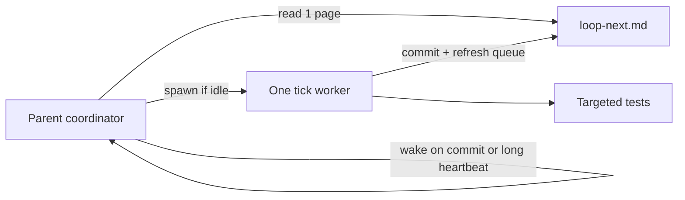

# Run Emberwood, remaining work, cheaper loop

## Run the game (after you approve)

Several leftover `python3 -m http.server` sessions exist; reuse one live origin if it still serves this repo, otherwise start one on a free port (`8765` if free, else the next free port).

Then the parent (not a nested tick) opens Glass with `cursor-app-control` `open_resource` `{ "uri": "http://127.0.0.1:<port>/" }`. Title screen: **Click here to play**. Tests stay at `/tests/run.html` (do not steal the play tab).

Playable today: 9 zones, Keys.js WASD/arrows, click-to-walk + purple A*, talk/quest, turn-based battle, ground loot + auto-pickup, HTML HUD. Suite last reported **80/80**. Phaser 3.90.0, no bundler.

## Remaining tasks (from [loop-tasks.md](loop-tasks.md))

**Scoreboard:** 294 items, **63 done**, **51 verify**, **~180 todo** (including 5 Stretch), 0 `doing`. Loop rule: first `verify` in a section, else first `todo`. Do not start Stretch until the matching core section is done.

**Next verifies the loop should burn before new todos in those sections**

- Combat: auto-attack **off**; `engageGrace` 800/700ms; battle list + canvas targeting; gold target rect; XP-on-win (style + Hitpoints); eat/run/death HUD; HP bars; worn display-only; mob respawn ~18s + wander.
- Inventory: eat shrimp/bread; coins `addItem`/`takeItem`; stack merge.
- Skills: `gainSkillXp` curve; Hitpoints level-up HP; skill SVG paths.
- Loot: not auto-added on win; sprite offset; 20s expiry; `clearLoot`; lock blocks pickup; prune safety.
- Quest HUD strings (Bram stages, any-Goblin kill rule).
- HUD: F1–F8 / tabs / styles / auto-attack sync / side stats / chat 40-line cap / title start.

**Highest-value todos (gameplay gaps vs OSRS-like brief)**

- Movement: Esc cancel walk; run energy; right-click Walk here; yellow destination X.
- World: persist mobs + ground loot across zones; interiors; examine scenery.
- NPCs: multi-page dialogue; shopkeeper; Elise → bank booth.
- Combat: reconcile `levelHero` (XP/40) vs `maxHp = 10 * hitpoints` in [js/data/Items.js](js/data/Items.js); gravestone respawn; wear gear applying damage.
- Inventory: 28-cap; drop-to-ground; load `item-sword` / `item-shield` in BootScene.
- Gathering + shop + bank (whole sections 7–8 still almost empty).
- Persistence (`localStorage` Continue/New game).
- `<title>Emberwood</title>` (currently missing in [index.html](index.html)).

**Known issues (not all tracked as bugs)**

- Prayer/Magic panels are stubs; leftover [js/ui/Menu.js](js/ui/Menu.js) / [js/ui/Message.js](js/ui/Message.js).
- No shop/bank UI; loot wiped on `enterZone`; goblin kills count any zone.
- Worn sword/shield display-only; death dumps to title (no gravestone).
- Inventory has no 28-cap; BootScene does not load sword/shield item textures.
- 30-second loop skip-spam (token + collision problem below).

## Why the current loop burns tokens

Cadence in [AGENT.md](AGENT.md) and [loop-tasks.md](loop-tasks.md) is **30 seconds**. A real tick takes **5–15+ minutes**. Every idle wake still:

1. Re-injects this long chat (AGENT.md + 430-line PM + prior ticks).
2. Makes the parent decide skip vs spawn (often skip because a worker is `doing`).
3. Often dumps the full brief into a Task prompt and re-runs the **full 80-case suite**.

Skip ticks are the expensive part: dozens of parent turns that ship nothing.

## Cheaper loop (docs + tiny queue file; no gameplay change)

Change process only: [AGENT.md](AGENT.md), [loop-tasks.md](loop-tasks.md) pick rules, plus a new **tick card**.

**Wake less**

- Stop the 30s `while true; sleep 30` loop.
- Use the Loop skill **dynamic** mode: one worker at a time; next wake is **when the worker finishes** (commit / `doing` cleared), with a **8–10 minute** fallback heartbeat only if the worker died silently.
- Skip with **no spawn and no user-facing essay** (one silent no-op or a single log line in the tick log, not a chat dump).

**Read less per tick**

- Add [loop-next.md](loop-next.md): the next **5** actionable lines (status, one-line spec, likely files, likely test name). Parent reads **only this file** + `git status`.
- Optional `tools/loop-next.py`: scan [loop-tasks.md](loop-tasks.md) top-to-bottom and rewrite `loop-next.md` after each commit so agents never grep 294 items.
- Task prompt stays ~15 lines: item text, 2–4 file paths, `node tests/playwright-session.js` + **one** `interactions.js` case name. Do **not** paste AGENT.md or the full PM.

**Test less**

- Default: run the **matching case** (and WASD only if the tick touched [js/input/Keys.js](js/input/Keys.js)).
- Full `/tests/run.html` suite only when shared files changed (`WorldScene`, `Keys.js`, `Hud.js`, harness) or the dedicated case is flaky.
- Keep headless Playwright; Glass only when you ask (this approval counts as asking **once** for play).

**Serialize work**

- Keep one spawned tick. If `doing` is set, do not spawn. That remains the conflict rule; the cheaper part is **not waking every 30s to re-check it**.

Do not implement gameplay in the same pass as this process change (standing rule). After the loop docs land, the next spawned tick should pick Combat **auto-attack off** (first verify in section 4).
