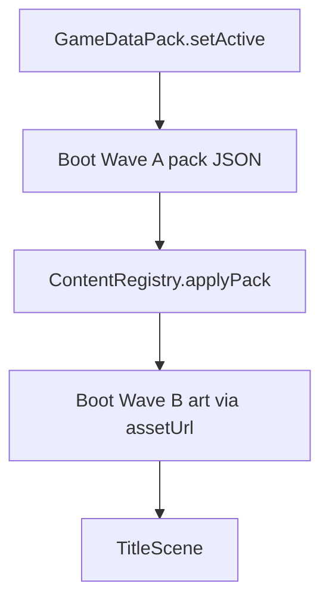

# GameDataPack: full content under `game-data/game1`

## Goal

- **One folder = one game:** [`game-data/game1/`](game-data/game1/) holds **all** Emberwood content — JSON tables **and** art (`assets/`).
- **JS = engine only** — pipelines, MapGen algorithms, TILE contract, Hud/WorldScene logic. No content literals / sync `*-data.js`.
- **Swap packs:** `GameDataPack.setActive('game2')` (or `?pack=game2` / `window.EMBERWOOD_PACK`) loads [`game-data/game2/`](game-data/game2/) with the **same** engine scripts.
- **No bundler** — Phaser `load.json` / `load.image` / `load.svg` with pack-relative URLs.

## Target layout

```text
game-data/
  game1/                         # Emberwood (default)
    pack.json                    # id, title, version, files{}, assetRoot, saveKey
    balance.json
    items.json                   # icon paths relative to pack root or assetRoot
    shops.json
    recipes.json
    gather-by-zone.json
    loot.json
    zones.json
    npcs.json
    zone-mobs.json
    skills.json
    mob-scales.json
    hero-defaults.json
    art-manifest.json            # tiles, player, legacy pngs, mobSvgs[], npcSvgs[], hudUi[]
    map/
      dimensions.json
      props.json                 # campfires, houses, bank, den gate, dungeon stairs, …
    assets/                      # moved from repo-root assets/
      tiles.png
      player.png
      …                          # slime/bat/drake/sign/npc + map.json if needed
      svg/
        items/ mobs/ npcs/ skills/ ui/
  game2/                         # future second game (not shipped now)
    pack.json + …
```

Repo-root [`assets/`](assets/) and [`js/content/*-data.js`](js/content/) go away after migration (optional stub README pointing at `game-data/`).

### Path convention

- All loadable URLs go through **`GameDataPack.assetUrl(rel)`** → `game-data/{packId}/` + rel (e.g. `assets/svg/items/coins.svg`).
- JSON icon fields store **pack-relative** paths (`assets/svg/items/coins.svg`), never hard-coded `game-data/game1/…`, so the same JSON shape works for any pack id.
- `pack.json` example fields:

```json
{
  "id": "game1",
  "title": "Emberwood",
  "version": "fw03",
  "assetRoot": "assets",
  "saveKey": "emberwood-save-game1",
  "files": {
    "balance": "balance.json",
    "items": "items.json",
    "artManifest": "art-manifest.json",
    "mapProps": "map/props.json"
  }
}
```

## GameDataPack API (new)

New [`js/core/GameDataPack.js`](js/core/GameDataPack.js) (loaded before ContentRegistry / Boot):

| Method | Role |
|--------|------|
| `setActive(id)` / `getActive()` | Current pack id (`game1` default) |
| `rootUrl()` | `game-data/{id}/` |
| `url(rel)` / `assetUrl(rel)` | Pack-root-relative URL + `?v=` from pack version |
| `loadJsonWave(scene)` | Queue every `pack.files` entry on `scene.load` |
| `resolveFromQuery()` | Optional `?pack=` / `window.EMBERWOOD_PACK` |

[`ContentRegistry.applyPack(cache)`](js/core/ContentRegistry.js): apply all JSON keys into globals (ITEM_DB, shops, recipes, gather, loot, zones, NPCs, roster builders, skills, scales, hero defaults, map props).



## Boot two-wave (required)

Today Boot assumes sync `ITEM_DB` before preload. After the move:

1. **Wave A:** `pack.json` + all table JSON.
2. **Apply** ContentRegistry (fills ITEM_DB, map props, art-manifest).
3. **Wave B:** tiles/player/legacy PNGs + mob/npc SVGs from manifest + every `ITEM_DB[*].icon` via `GameDataPack.assetUrl`.
4. Anims → Title (document.title from `pack.title`).

[`index.html`](index.html): drop `*-data.js` tags; keep engine scripts; set default pack once.

## HUD / HTML asset paths

[`index.html`](index.html) hard-codes dozens of `src="assets/svg/ui/…"` and skill icons. After the move those break unless:

- **Chosen approach:** small boot-strap in `main.js` / Hud init rewrites `[data-pack-src]` or `.pix[src]` through `GameDataPack.assetUrl`, **or** inject a `<base>`-unsafe alternative: set `img` src from JS using paths listed in `art-manifest.hudUi`.
- Favicon `<link rel="icon">` must also use the pack URL (set from JS after pack id known).
- [`itemIcon`](js/data/Items.js) / skill SVG helpers must prefix via `GameDataPack.assetUrl` (today they return raw `assets/…` strings used as Phaser load paths **and** DOM `img src`).

## Save isolation

[`Save.js`](js/data/Save.js) must key localStorage by **`pack.saveKey` or `emberwood-save-{packId}`**. Mixing game1/game2 under one key would corrupt heroes / world blobs.

## Phased execution

### Phase A — Move tree + GameDataPack + Boot
- Create `game-data/game1/`; move JSON from `js/content/`; **move** repo `assets/` → `game-data/game1/assets/`.
- Implement GameDataPack + ContentRegistry.applyPack; two-wave Boot; delete `*-data.js`.
- Rewrite item icon paths in JSON if needed (keep pack-relative `assets/…`).

### Phase B — Map props JSON
- Extract MapGen coordinate/prop tables into `map/props.json` + `dimensions.json`.
- Keep TILE enum + generation algorithms in MapGen (engine).

### Phase C — HUD + saves + remaining tables
- skills / mob-scales / hero-defaults / art-manifest.
- Hud + index.html asset resolution; Save.js pack-scoped keys.
- Retarget [`tools/generate_assets.py`](tools/generate_assets.py) / SVG generators to write under `game-data/game1/assets/`.

### Phase D — Docs + second-pack contract
- [`docs/framework.md`](docs/framework.md): pack layout, how to clone `game1` → `game2`, engine vs pack boundary.
- Copy this plan to [`.cursor/plans/game-data-pack.plan.md`](.cursor/plans/game-data-pack.plan.md) (`isProject: true`).
- loop-tasks + local commit. No push. Testing stays disabled.

## Explicit non-goals

- No bundler / TypeScript.
- No full MapGen algorithm rewrite / WorldScene peel.
- No polished in-game pack picker (query/constant switch is enough).
- Do not ship a real `game2` content set in this work (folder contract only).
- Testing remains disabled.

## Success criteria

- No content tables / art under repo-root `assets/` or `js/content/*-data.js`.
- Engine JS has no hard-coded `assets/…` load paths (only `GameDataPack.assetUrl` / pack files).
- `GameDataPack.setActive('game2')` + a valid tree would boot without editing WorldScene/Items logic (missing files fail loudly in Boot).
- Saves for game1 do not overwrite game2.
- Human playtest: Boot → Haven → bank/shop/gather with art visible.

---

## Possible issues (read before implementing)

### Hard breakages if missed
- **HUD HTML still points at `/assets/…`** — UI icons vanish after the folder move; must rewrite or JS-fix.
- **Item/skill icon helpers** return paths used both by Phaser and DOM — must be pack-aware everywhere (Hud grids, ground loot textures already loaded in Boot).
- **Asset generators / docs / plans** still say `assets/tiles.png` — tools would write to the wrong place until retargeted.
- **Tests / Playwright** (when re-enabled) may assume root `assets/` URLs.

### Engine ↔ pack coupling (second game is not free)
- **TILE indices + tilesheet layout** are an engine contract: `game2` must use the same frame indices MapGen/WorldScene expect, **or** ship a tilesheet that matches, **or** later make TILE/collide lists data-driven (out of scope now). A prettier art pack with a different atlas will desync collision/gather frames.
- **MapGen algorithms** (town layout, shore water, mine) still encode Emberwood structure; props JSON only moves coordinates. A truly different world may need new generators or hand-made maps — not solved by folder move alone.
- **Skill ids / combat triangle / gather kinds** (`fish`/`chop`/`mine`) are referenced in logic; `game2` can rename display strings in JSON but cannot drop systems without code changes.
- **Zone ids** (`haven`, `darkmine`, …) appear in WorldScene special cases (den gate, dungeon). A new pack must either reuse those ids or we later data-drive those branches.

### Runtime / product
- **Save collisions** across packs without namespaced keys.
- **Mid-session pack switch** — unsupported; textures/globals already applied. Only boot-time selection.
- **Cache busting** — every pack file needs `?v=`; forgetting leaves stale JSON/art after edits.
- **`file://` still unsupported** — HTTP required for `load.json` (unchanged).
- **Pack size / Boot time** — two-wave load is slightly slower; fine for ~1MB art.
- **Shared CDN engine assumption** — one `index.html` for all packs; branding (title, favicon, loading text) must come from `pack.json`.
- **Optional legacy PNGs** (`slime.png`, etc.) may be unused if SVG mobs cover them — still move them; prune later.

### Process
- Large git move (`assets/` → `game-data/game1/assets/`) — prefer `git mv` to preserve history.
- Dual docs (`AGENT.md` vs framework) must both describe the pack root or agents will keep writing into `js/content/`.
