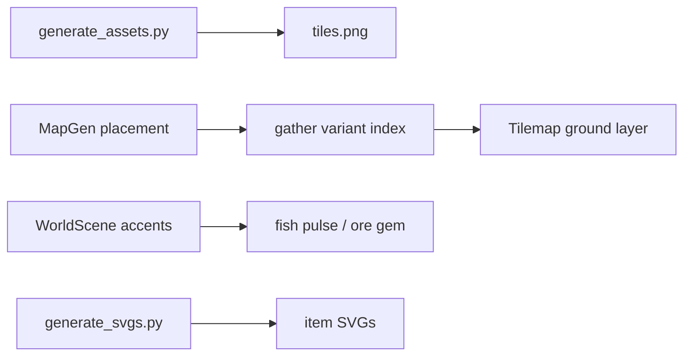

# Resource per-type visuals + standout gather tiles

## Findings

World gather nodes are **tile frames** from [`assets/tiles.png`](assets/tiles.png) (built by [`tools/generate_assets.py`](tools/generate_assets.py)), not BootScene SVGs.

| Resource | Logic types | World art today | Problem |
|----------|-------------|-----------------|---------|
| Trees | `logs`…`magiclogs` via `TREE_BY_ZONE` | Single `TILE.TREE` | Species not distinct; blends with “just another tree” |
| Ores | `copper`…`runeessence` | Single `TILE.ROCK` + tint + blobs | Transparent rock corners → **black boxes**; tiers tint-only |
| Fish | `rawshrimp`…`rawshark` via `FISH_BY_ZONE` | **Same `TILE.WATER`** as ocean/swamp; pulse FX Southshore only | Spots do not stand out from water |
| Inv icons | same ids | Shared SVG paths | Tiers look identical in inv/loot |

**Requirement (this revision):** fishing tiles must be **different from water tiles**. All resource gathering spots (trees, ores, fish) must **stand out from ordinary terrain** — not only from each other.

Rock paint today has no underfill (transparent corners). Tree already fills grass under canopy — copy that for rock/ore and use a clearly different fish-spot frame (not a water clone).

## Approach

Bake **dedicated gather frames** into the tilesheet. Ordinary `WATER` / plain `ROCK` / generic border `TREE` stay for scenery; gather nodes use marked variants so players can spot them at a glance.

## 1. Fix black ore backgrounds

In [`tools/generate_assets.py`](tools/generate_assets.py), before drawing any rock/ore ellipse:

- Fill the full 16×16 with grass noise (or darkmine floor gray for underground ore frames).
- Rebuild `assets/tiles.png`.
- Stop relying on full-tile Phaser tint for ore identity once veins are baked.

## 2. Standout tiles per gather family

**Tilesheet** — expand `TILE_COUNT` and add frames (all **fully opaque**):

| Family | Frames | How they stand out from normal tiles |
|--------|--------|--------------------------------------|
| Trees | `TREE`, `TREE_OAK`, `TREE_ASH`, `TREE_YEW`, `TREE_MAGIC` | Distinct canopy/trunk; choppable trees use these — border/filler may keep generic TREE or a duller non-gather look if needed |
| Ores | `ROCK`, `ROCK_COPPER`, `ROCK_IRON`, `ROCK_DIAMOND`, `ROCK_DRAGONITE`, `ROCK_ESSENCE` | Opaque underfill + baked vein color; plain ROCK for non-mine scatter if any |
| Fish | `FISHSPOT`, `FISHSPOT_TROUT`, `FISHSPOT_LOBSTER`, `FISHSPOT_SWORDFISH`, `FISHSPOT_SHARK` (shrimp = base) | **Not `WATER`** — e.g. brighter cyan/foam ring, ripple glyph, or lily/bubbles so shore water stays plain |

**MapGen** ([`js/world/MapGen.js`](js/world/MapGen.js)):

- New `TILE.*` indices; collide/walk:
  - All `TREE_*` → same as TREE (block).
  - All `ROCK_*` → same as ROCK (block).
  - All `FISHSPOT_*` → same as WATER for pathing (block walk) but scenery kind `fishspot` (not generic water examine).
- Tree scatter / zone trees → frame from `TREE_BY_ZONE[zoneId].log`.
- Ore node placement → matching `ROCK_*` (not generic ROCK + tint).
- Fish spot placement (`FISH_SPOTS_BY_ZONE`, `SHORE_PROPS.spots`, etc.) → set **`FISHSPOT_*`**, never leave as `WATER`.
- Update `woodcutTreeAt` / `mineRockAt` / `pickScenery` / deplete→grass / fish helpers to accept all variant indices. Depleted fish spots can revert to `WATER` so the gather tile disappears until respawn.

**WorldScene** ([`js/scenes/WorldScene.js`](js/scenes/WorldScene.js)):

- Ore: drop muddy full-tile tint; optional small gem accent on top of baked veins.
- Fish: pulse/ripple accent on **all** fish-spot tiles (every zone), colored by catch tier — accents reinforce the dedicated tile, not replace it.

## 3. Distinct item icons

In [`tools/generate_svgs.py`](tools/generate_svgs.py) + [`js/data/Items.js`](js/data/Items.js):

- New SVGs for log tiers, ore tiers, raw/cooked fish tiers currently sharing shrimp/copper/tin/airrune art.
- Rewire `ITEM_DB[id].icon`; BootScene loads via `itemTextureKey`.

## 4. Docs / tracking

- [`loop-tasks.md`](loop-tasks.md) row; GDD note that gather nodes use dedicated frames (fish ≠ water; ores opaque; trees/ores typed).
- Copy this plan into [`.cursor/plans/`](.cursor/plans/) with `isProject: true`.
- Cache-bust tilesheet + MapGen/WorldScene/Items; local commit; no tests.

## Out of scope

Tool/weapon SVG reuse (axes/picks sharing bronze art). Ordinary decorative WATER/ROCK/TREE that are not gather targets stay as today aside from rock underfill if the base ROCK frame is shared.
