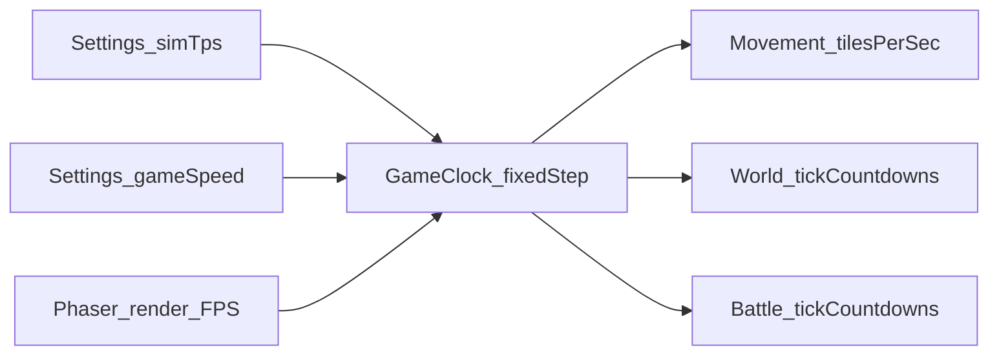

# TPS-driven game clock, Game Speed, and tile-speed movement

## Current state

- Render/physics capped at 60 in [`js/main.js`](js/main.js) (`fps.target/limit`, arcade `fps: 60`). FPS|TPS readout counts Phaser `step` vs `postrender` (same loop today).
- Movement uses **px/sec** arcade velocities: `WALK_SPEED = 90`, `RUN_SPEED = 180` in [`js/scenes/WorldScene.js`](js/scenes/WorldScene.js) (~5.625 / 11.25 tiles/sec at `TILE_SIZE` 16).
- Most “actions” are **wall-clock**: `time.delayedCall` / `addEvent` for gather (3–5s), overworld combat (`OW_COMBAT_TICK_MS = 600`), mob respawn, mining FX; HP/run use `delta` seconds.
- [`BattleScene.js`](js/scenes/BattleScene.js) uses `time.addEvent` / `delayedCall` for turns and end-battle delays.

## Approach

Use a **fixed simulation timestep** with clear authoring units and **two Settings knobs**:

| Concern | Author as | Per sim tick |
|---------|-----------|--------------|
| Movement | **tiles/sec** (at gameSpeed 1) | `px = tilesPerSec * gameSpeed * TILE_SIZE / tps` |
| Durations (combat, fish, chop, mine, regen, battle turns) | **game seconds** (at gameSpeed 1) | `ticks = round((seconds / gameSpeed) * tps)` |

**TPS (`simTps`, default 60)** — simulation resolution only. With the formulas above, changing TPS alone does **not** change wall-clock feel.

**Game Speed (`gameSpeed`, default 1.0)** — global feel multiplier (e.g. 0.5×–2×). Scales movement tiles/sec and shortens/lengthens authored durations so the whole game runs slower or faster consistently.

Do **not** overload TPS as game speed (that would desync tile/sec movement from tick-scheduled actions).

`TILE_SIZE` stays **16** (no map rescale); it is only the conversion factor for tiles ↔ pixels.

## Design

### 1. `GameClock` module (new [`js/world/GameClock.js`](js/world/GameClock.js))

- `DEFAULT_TPS = 60` (clamp e.g. 20–120); `DEFAULT_GAME_SPEED = 1` (clamp e.g. 0.5–2).
- `getTps()` / `setTps(n)`; `getGameSpeed()` / `setGameSpeed(n)`.
- Helpers:
  - `secondsToTicks(sec)` using `tps / gameSpeed`
  - `tilesPerTick(tilesPerSec)` / `pxPerTick(tilesPerSec)` using `tilesPerSec * gameSpeed * TILE_SIZE / tps`
  - `effectiveTilesPerSec(tilesPerSec)` → `tilesPerSec * gameSpeed`
- Fixed-step accumulator from scene `update(time, delta)`:
  - `stepMs = 1000 / tps`; `accum += delta`; while `accum >= stepMs` → `simTick()` (cap catch-up iterations).
- WorldScene and BattleScene both advance the same clock (or each scene runs the accumulator against shared TPS/speed settings).

Persist `hero.simTps` and `hero.gameSpeed`; normalize defaults on load.

### 2. Settings UI

In Settings ([`index.html`](index.html) / [`js/ui/Hud.js`](js/ui/Hud.js) / [`js/ui/HudApp.js`](js/ui/HudApp.js)):

- **Ticks per second (TPS)** — slider or select (30 / 60 / 120), default **60**.
- **Game speed** — slider or select (0.5× / 1× / 1.5× / 2×), default **1×**.
- Applying either control calls GameClock setters and **recomputes** open combat/gather/battle countdowns from remaining game-second fraction so mid-change stays smooth.
- FPS|TPS readout: show **sim TPS** (and optionally game speed in Settings only).

### 3. Movement → tiles per second

In [`WorldScene.js`](js/scenes/WorldScene.js) / [`OverworldCombat.js`](js/world/OverworldCombat.js):

- Replace px constants with:
  - `WALK_TILES_PER_SEC` ≈ `90/16`
  - `RUN_TILES_PER_SEC` ≈ `180/16`
  - Mob speeds via existing `mobMoveSpeed` factors, in tiles/sec, still ≤ half base walk before gameSpeed.
- Each **sim tick**, apply movement using GameClock (`setVelocity` from `effectiveTilesPerSec * TILE_SIZE`, or integrate `pxPerTick`).
- **Concrete choice:** keep Arcade bodies; each sim tick set velocity from effective tiles/sec × `TILE_SIZE` (wall px/sec at current speed). Per-tick displacement ≡ `tilesPerSec * gameSpeed / tps` tiles.

### 4. World actions on ticks

Migrate to `ticksLeft` countdowns on gather/combat/respawn/deplete/regen:

- Overworld combat beat: `0.6s` → `secondsToTicks(0.6)` (replaces `OW_COMBAT_TICK_MS`).
- Gather: 3–5s windows → tick ranges via GameClock.
- HP regen / run energy: per sim tick using `1/tps` game seconds × `gameSpeed` (or fold speed into the helper consistently).
- Replace gameplay `delayedCall` with tick countdowns; pure cosmetic VFX may stay wall-clock or also use ticks for consistency.

### 5. BattleScene on ticks

In [`BattleScene.js`](js/scenes/BattleScene.js) (and related Hud battle helpers if they schedule scene timers):

- Drive turn cadence / AI act delays / end-battle wait through GameClock tick countdowns (same `secondsToTicks` authoring as overworld).
- Share TPS + gameSpeed so battle and overworld feel match when speed changes.
- Remove reliance on wall-clock `turnTimer` `addEvent` delays for gameplay pacing.

### 6. Phaser config

- Keep **render** `fps.limit` at 60.
- Simulation from accumulator at `simTps` (independent of render).
- Arcade `fps` stays 60 unless profiling requires matching sim.

### 7. Tracking / docs

- Log in [`loop-tasks.md`](loop-tasks.md); mark done with conclusion (no suite proof while testing disabled).
- Note TPS + Game Speed in GDD/settings docs if present.
- Local commit; cache-bust touched scripts; load `GameClock.js` from [`index.html`](index.html).

## Risk notes

- Mid-fight / mid-gather TPS or speed change: recompute `ticksLeft` from remaining fraction.
- Catch-up spiral: max N sim ticks per frame.
- Keep world + battle on the same clock so gameSpeed never desyncs the two.
- Do not leave any gameplay timer on raw `delayedCall` ms after migration.
