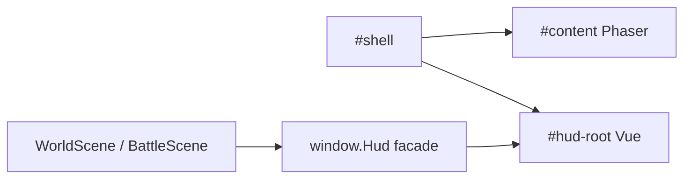

# Vue CDN for Emberwood GUI

## Answer

Yes. Vue 3’s **global build** (`vue.global.prod.js` from jsDelivr/unpkg) runs with plain `<script>` tags — same model as Phaser today. No npm, no Vite, no SFC compiler needed if we use in-DOM templates + Options API.

## Constraint (do not break Phaser)

Phaser mounts into `#content` ([js/main.js](js/main.js)). Vue must **not** own that node (re-renders would destroy the canvas).



Layout change in [index.html](index.html): keep `#content` as a sibling; move aside / bottom / overlays into `#hud-root` and `createApp(...).mount('#hud-root')`.

## Phaser ↔ Vue communication (detail)

### Source of truth (locked)

- **Phaser always holds the real game logic and data** — `game.registry` (`hero`, `quest`), scene fields (`zoneId`, `encounterLock`, battle turns), and all rules (combat, skilling, inventory, zones).
- **Vue only reflects that state** — a reactive display mirror (hp, gold, tab, chat lines, mode/overlay flags, inv/skills snapshots). Vue never invents, caches as authority, or computes gameplay outcomes.
- **Direction 1 is the primary contract:** after Phaser mutates something visible, push a snapshot into Vue via `Hud` (`setWorld`, `renderHero`, `log`, mode helpers). No Vue polling of the registry.
- UI clicks (Direction 2) are allowed only as **thin relays** into existing `Hud` / scene methods; they must not contain game rules. After the relay mutates Phaser data, Direction 1 push runs again so Vue catches up.

Today this already exists without Vue: `WorldScene.refreshHud()` reads `registry` and calls `Hud.setWorld({ zone, hp, gold, … })`, and `Hud.renderHero(hero)` writes DOM. Vue replaces the DOM write step, not the ownership model.

### Bridge object: keep `window.Hud`

Scenes already call a global facade (`Hud.log`, `Hud.mode`, `Hud.showBattle`, `Hud.saveHero`, …). That stays the **only** Phaser→UI contract.

```text
WorldScene / BattleScene / Items.js
        │  Hud.log / refreshHud / showBattle / mode
        ▼
   window.Hud  (facade + game actions)
        │  assigns reactive fields / calls methods
        ▼
   Vue app state  (ref/reactive)
        │  template bindings
        ▼
   HTML HUD
```

Implementation shape:

- `HudApp.js` creates the Vue app and exposes `HudApp.state` (or `Hud.vm`).
- `Hud.setWorld(data)` becomes `Object.assign(HudApp.state, data)` instead of `el.hp.textContent = …`.
- `Hud.log(line)` pushes onto `state.chatLines` (cap 40) instead of appending DOM nodes.
- `Hud.mode = 'battle'` stays a real property on the facade (scenes read it); Vue also binds `v-show="mode === 'battle'"` from the same value (synced into `state.mode` whenever mode changes).

### Direction 1 — Phaser → Vue (reflect game state)

**When:** after anything the player should see change.

| Event | Who calls | What Vue receives |
|-------|-----------|-------------------|
| Zone enter / spawn | `WorldScene.refreshHud()` | zone name, hp, gold, xp, combat level, skill total, quest text |
| Fish/chop/mine/loot/eat | scene + `Hud.saveHero` + `refreshHud` / `renderHero` | hp, inv, skills, gold |
| Level-up / XP drop | `gainSkillXp` → `Hud.log` / modal helpers | chat line + modal flags |
| Enter battle | `Hud.showBattle(battle)` | `mode='battle'`, battle panel visible, enemy list, message |
| Leave battle / title / dead | `hideBattle` / `showTitle` / dead overlay | `mode` + overlay flags |

**Pattern (push, not poll):**

```js
// WorldScene (unchanged call site)
this.refreshHud(); // builds snapshot from registry

// Hud.setWorld → Vue
HudApp.state.zone = data.zone;
HudApp.state.hp = data.hp;
HudApp.state.maxHp = data.maxHp;
// …
```

Do **not** bind Vue computed properties that deep-read Phaser objects every tick. Phaser objects are not Vue-reactive; polling `registry` from Vue would be fragile and expensive. Explicit snapshots after mutations match the current `refreshHud` design.

**High-frequency fields** (run energy bar): keep the existing scene/HUD update path; it assigns `state.runEnergy` / bar width when `tickRunEnergy` / `renderRun` already fire — still push, just more often. No `requestAnimationFrame` Vue polling.

### Direction 2 — Vue → Phaser (input relay only)

Vue may receive clicks, but **must not own outcomes**. Handlers only forward to existing Hud/scene APIs; Phaser mutates truth; then Direction 1 refreshes the mirror.

| UI action | Vue does | Phaser / Hud does |
|-----------|----------|-------------------|
| Title Start | `@click` → `Hud.onStart()` | start world, set mode |
| Tab bar / F-keys | set `state.tab` (pure chrome) | nothing gameplay |
| Attack / Eat / Run | call `Hud.tryAttack` etc. | BattleScene resolves turn |
| Inv / Use / equip | call existing Hud item methods | mutate `hero`, then `renderHero` |
| Run toggle | call `Hud.toggleRun()` | flip `hero.running`, push run UI |
| Minimap / Walk here | call existing Hud walk helpers | `WorldScene.setWalk` / zone walk |

Pure chrome (which tab is open, credits text visible) may live in Vue. Anything that changes the character, world, or combat stays in Phaser.

### Mode flag (shared gate)

Scenes gate input with `Hud.mode` (`title` | `world` | `battle` | `dead`). That must remain a synchronous property scenes can read mid-frame.

- Store on `Hud.mode` (facade).
- On every mode change, also set `HudApp.state.mode` so overlays `v-show` correctly.
- Never make `Hud.mode` a Vue-only ref that Phaser has to `.value` through — keep a plain string on the facade.

### What not to do

- Put `hero` itself into Vue `reactive()` as the live object Phaser mutates — easy to desync and surprise Phaser with proxies.
- Let Vue own inventory truth — inventory stays on `hero.inventory`; Vue gets a **rendered snapshot** (`invSlots` array) rebuilt in `renderInventory`.
- Mount Vue over `#content` — canvas dies on re-render.
- Use Vue events as a second bus while also calling Hud methods ad hoc — pick **Hud facade as the bus**.

### Sync checklist for each feature touch

1. Mutate Phaser/`hero` / registry.
2. Persist if needed (`Hud.saveHero`).
3. Push UI (`refreshHud` / `renderHero` / `Hud.log` / mode helpers).
4. Vue templates update from reactive mirror.

That is the same pipeline as today; Vue only replaces step 3’s DOM writes.

## Approach (concrete)

**Progressive but real GUI ownership:** Vue owns the visible HUD markup and reactive display state. Keep `window.Hud` as the Phaser-facing API (`Hud.log`, `Hud.mode`, `refreshHud`, bank/shop helpers) so scenes do not need a mass rewrite.

1. **Add Vue CDN** next to Phaser in [index.html](index.html) (pin a 3.x prod global build, e.g. jsDelivr `vue@3.5.x/dist/vue.global.prod.js`). Bump `?v=` on HUD scripts.
2. **New file** [js/ui/HudApp.js](js/ui/HudApp.js): `Vue.createApp` with reactive state (`mode`, `zone`, `hp`, `gold`, `xp`, `level`, `total`, `run`, `quest`, `tab`, `chatLines`, title/dead/credits flags, combat panel visibility, toggle button labels). Methods for tab clicks, start/credits/respawn, run toggle — call into existing Hud game logic where needed.
3. **Refactor** [js/ui/Hud.js](js/ui/Hud.js):
   - `init` creates/mounts the Vue app (or assumes `HudApp.mount()` already ran).
   - Replace `el.hp.textContent = …` style updates with assignments on the Vue reactive model.
   - Keep imperative code for bank/shop/dialogue/context menu **inside** Vue-owned DOM initially via `ref`s + existing builders, then switch grids to `v-for` where cheap (skills list, inv slots, chat lines first).
4. **Chat**: store lines in Vue array; `Hud.log` pushes and trims to 40 (current behavior).
5. **Tabs / side stats / title / dead / battle panel chrome**: Vue `v-show` / bindings instead of `hidden` + `textContent`.
6. **Docs**: note in [AGENT.md](AGENT.md) + [README.md](README.md): Vue CDN, no build; Phaser stays outside Vue root.
7. **Playtest** locally (and Pages after push if you ask): title → play, WASD, tab switch, chat, HP/gold update after combat/loot.

## Out of scope this pass

- Vue SFCs / Vite / npm
- Rewriting Phaser scenes to import Vue components
- Perfect Vue rewrite of every bank/shop edge case on day one (they stay as Hud methods operating on Vue-mounted refs until a follow-up)

## Risk note

Largest risk is Vue replacing `#content`. Mount boundary above is mandatory. Second risk: tests that query fixed DOM ids — keep the same `id`s on Vue template nodes so [tests/interactions.js](tests/interactions.js) keeps working without a suite run unless you ask.